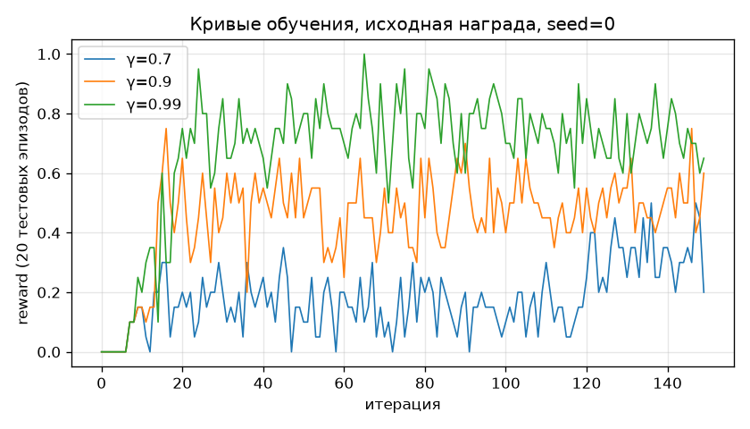
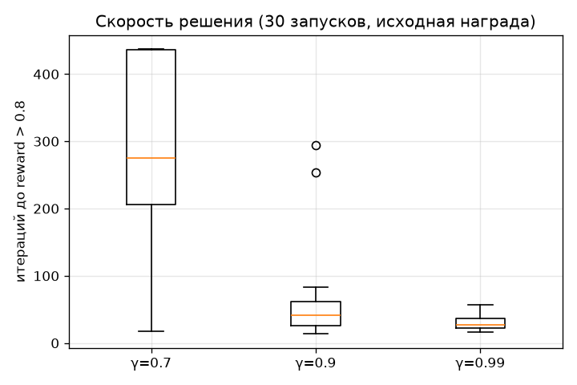
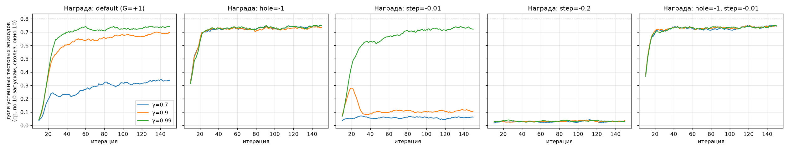
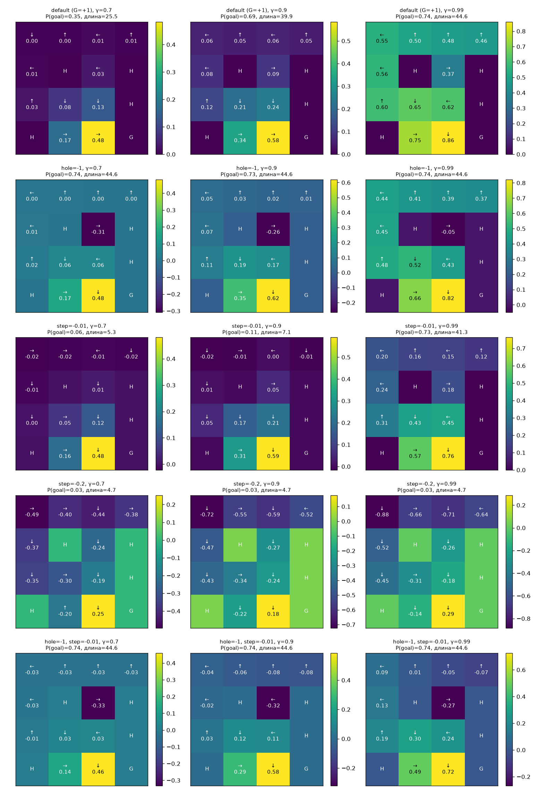

# Лабораторная работа 1. Обучение стратегии поведения с помощью алгоритма итерации по ценностям действий

**Цель:** реализовать и исследовать алгоритм итерации по ценностям действий (Q-iteration) для среды FrozenLake.

## Состав

| Файл | Назначение |
|---|---|
| `q_iteration.py` | Агент из методички: таблицы вознаграждений/переходов, Q-таблица, `play_n_random_steps`, `select_action`, `play_episode`, `Q_iteration`, цикл обучения до `reward > 0.8` |
| `experiments.py` | Эксперименты: γ ∈ {0.7, 0.9, 0.99} × 5 функций вознаграждения, по 10 запусков; графики и сводка |
| `results/` | Графики, `log.txt` (вывод экспериментов), `summary.json` (все числа и стратегии) |

Запуск:
```bash
pip install -r requirements.txt
python q_iteration.py     # обучение (γ=0.9) + визуализация одного эпизода
python experiments.py     # все эксперименты (~4 мин)
```

**Отличия от методички.** Вместо устаревшего `gym` используется `gymnasium`: среда `FrozenLake-v0` → `FrozenLake-v1`
(та же карта 4×4, скользкий лёд, лимит 100 шагов), `reset()` возвращает `(obs, info)`, `step()` — `(obs, r, terminated, truncated, info)`.
Вместо tensorboard кривые рисуются matplotlib. Функция вознаграждения агента вынесена в параметр `reward_fn`, чтобы исследовать её влияние
(для оценки качества всегда используется исходная награда среды: 1 — дошёл до цели, 0 — нет).

## Методика оценки

Критерий методички («средняя награда на 20 тестовых эпизодах > 0.8») сильно зашумлён: по 20 эпизодам стандартное отклонение доли успехов ≈ 0.1.
Поэтому, помимо него, для каждой выученной стратегии **точно** (по матрице переходов среды `env.unwrapped.P`) считаются:
вероятность дойти до цели за 100 шагов `P(goal)`, вероятность провалиться `P(hole)` и ожидаемая длина эпизода.
Для сравнения также вычисляется эталонная Q-таблица итерацией по точной модели среды (`exact_value_iteration`) — «оптимум» для данных γ и награды.

Каждая конфигурация: 150 итераций (100 случайных шагов + одна Q-итерация), 10 сидов.

## 1. Базовый эксперимент (γ = 0.9)

Агент решает задачу по критерию методички в среднем за **57 итераций** (медиана 41, 30/30 запусков). Пример эпизода обученного агента
(`python q_iteration.py`):

```
  (Left)
SFFF
FHFH
...
  (Right)
SFFF
FHFH
FFFH
HFF[G]
```

Выученная стратегия (стрелки — действие в клетке):
```
← ↑ ← ↑
← H → H
↑ ↓ ↓ H
H → → G
```
Первое действие — **«влево»**, как и в методичке: упереться в стену выгодно — агент либо остаётся на месте, либо соскальзывает вниз,
но никогда не уходит вправо, к полыньям. Аналогично в клетках рядом с полыньями агент выбирает действие, **направленное от полыньи**,
т.к. из-за скольжения только перпендикулярные направления случайны — «идти в стену» оказывается безопаснее, чем «идти к цели».

## 2. Влияние γ



| γ | P(goal) выученной стратегии | P(goal) оптимальной при этом γ | средняя длина эпизода | итераций до `reward>0.8` (30 запусков) |
|---|---|---|---|---|
| 0.7  | 0.35 ± 0.09 | 0.45 | 25.5 | решено лишь 5/30 за 500 итераций |
| 0.9  | 0.69 ± 0.08 | 0.73 | 39.9 | 57 ± 61 (медиана 41) |
| 0.99 | **0.74 ± 0.00** | 0.74 | 44.6 | **31 ± 12** (медиана 28) |



Выводы:
* **γ = 0.99** — лучший результат: за ~30 итераций все 10 запусков приходят к одной и той же стратегии, дающей максимально возможную
  вероятность успеха ≈ **0.74** (за 100 шагов; без лимита шагов — ≈ 0.82).
* **γ = 0.7** — награда за цель, до которой в среднем > 40 шагов, дисконтируется почти до нуля (0.7^10 ≈ 0.03). Даже *оптимальная* при γ=0.7
  стратегия «торопится» и рискует (P(goal)=0.45): короткий рискованный путь для неё ценнее длинного безопасного.
  Кроме того, Q-значения в начальных клетках порядка 10⁻³, и погрешность оценки вероятностей переходов по выборке легко меняет argmax —
  отсюда большой разброс между запусками и медленная сходимость.
* **γ = 0.9** — промежуточный случай: стратегия близка к оптимальной, но в части клеток агент всё ещё предпочитает более короткий и опасный путь
  (например, «→» в клетке (3,2) вместо «↓», и «←» в клетке (0,2)).

## 3. Влияние функции вознаграждения

Исследованы 5 функций (исходная награда + 4 модификации):

| Награда | γ=0.7 | γ=0.9 | γ=0.99 | Поведение |
|---|---|---|---|---|
| исходная: +1 за цель | 0.35 | 0.69 | 0.74 | см. выше |
| **−1 за полынью** | **0.74** | **0.73** | **0.74** | оптимальная безопасная стратегия уже при γ=0.7 |
| −0.01 за шаг | 0.06 | 0.11 | 0.73 | при γ<0.99 агент **«самоубивается»**: P(hole)=0.89–0.94, длина эпизода ≈ 5–7 |
| −0.2 за шаг | 0.03 | 0.03 | 0.03 | при любом γ кратчайший путь в полынью (≈ 4.7 шага) |
| −1 за полынью, −0.01 за шаг | 0.74 | 0.74 | 0.74 | оптимальная стратегия, быстро и стабильно |

(в ячейках — точная P(goal) выученной стратегии, среднее по 10 запускам; значения совпадают с эталонными по точной модели)





Выводы:
* **Штраф за полынью** делает «падение» явно плохим исходом, а не просто «нулём, как везде». Сигнал о полыньях появляется сразу,
  а не только через дисконтированную награду от далёкой цели, поэтому оптимальная осторожная стратегия выучивается даже при γ = 0.7,
  и при этом быстрее (≈ 20 итераций до плато против ≈ 30–60).
* **Штраф за шаг без штрафа за полынью** опасен: падение в полынью завершает эпизод и **прекращает начисление штрафов**. Если ожидаемая сумма
  штрафов за долгий безопасный путь больше дисконтированной награды за цель, оптимально… как можно быстрее утопиться. При −0.2 за шаг так
  происходит при любом γ; при −0.01 — только при γ ≤ 0.9 (при γ=0.99 награда за цель ещё «перевешивает»).
  Это классический пример того, как неудачно подобранная функция вознаграждения формально оптимизируется, но приводит к нежелательному поведению.
* **Комбинация «−1 за полынью, −0.01 за шаг»** даёт лучшую и самую стабильную стратегию при всех γ.
* Умножение награды на константу (например, +10 за цель) стратегию не меняет — важны только соотношения наград и γ.

Замечание: в клетке (1,2) (между двумя полыньями) действия «←» и «→» строго эквивалентны по симметрии, поэтому расхождение там
между выученной и эталонной стратегией — это только выбор при равенстве Q-значений.

## 4. Общие выводы

1. Алгоритм итерации по ценностям действий с оценкой модели среды по случайным переходам успешно обучает агента FrozenLake:
   при γ = 0.99 он за ~30 итераций (≈ 3000 случайных шагов) находит стратегию, совпадающую с оптимальной по точной модели
   (P(goal) ≈ 0.74 при лимите в 100 шагов).
2. Выученная стратегия — «осторожная»: агент намеренно идёт в стену или от полыньи, пользуясь тем, что лёд скользит только в перпендикулярные стороны.
3. Малое γ делает агента «близоруким»: он предпочитает быстрые рискованные пути и обучается медленнее и менее стабильно.
4. Функция вознаграждения сильно влияет на стратегию: штраф за полынью ускоряет обучение и снижает зависимость от γ,
   а штраф за шаг без штрафа за провал приводит к «суицидальной» стратегии.

## Ответы на вопросы для самопроверки

1. **Отличия RL от других подходов.** Нет «правильных ответов» (как в обучении с учителем), но есть скалярный сигнал вознаграждения,
   часто отложенный во времени. Агент сам порождает данные своими действиями (компромисс исследование/использование),
   данные не независимы, решения влияют на будущие наблюдения.
2. **Ценность состояния vs ценность действия.** V(s) — ожидаемая отдача из состояния s при следовании стратегии; Q(s,a) — ожидаемая отдача,
   если в s выполнить действие a, а затем следовать стратегии. V(s) = maxₐ Q(s,a) для оптимальной стратегии. Q позволяет выбирать действие
   без знания модели переходов: a* = argmaxₐ Q(s,a).
3. **Оптимальность.** Да: при точно известных вероятностях переходов итерации сходятся (оператор Беллмана — сжатие при γ<1) к Q*,
   жадная стратегия по Q* оптимальна. В нашей реализации вероятности оцениваются по выборке, поэтому стратегия оптимальна
   лишь приблизительно — это видно при γ = 0.7, где различия Q-значений малы и шум оценок меняет выбор действия. При γ = 0.99
   выученная стратегия совпала с точным оптимумом.
4. **Недостатки.** Нужно перебирать все состояния и действия (не масштабируется на большие/непрерывные пространства);
   нужна таблица переходов (модель среды), которую приходится оценивать; сбор данных случайными действиями неэффективен;
   награда должна зависеть только от (s, a, s') (в коде хранится последнее наблюдённое значение).
5. **Стратегия агента FrozenLake.** Осторожная: из старта «влево», в верхнем ряду «вверх», у полыней — действия, направленные от них
   (см. раздел 1 и рисунок стратегий). Она оптимальна в смысле максимизации дисконтированной отдачи для заданного γ; при γ = 0.99
   она совпадает с оптимальной по точной модели и максимизирует вероятность дойти до цели (≈ 0.74 за 100 шагов, ≈ 0.82 без лимита).
6. **Можно ли получить среднюю награду 1?** Нет. Из-за скольжения из ряда клеток (например, (1,0), (2,1), (1,2)) при любом действии есть
   ненулевая вероятность упасть в полынью; к тому же эпизод ограничен 100 шагами. Поэтому максимальная вероятность успеха ≈ 0.74 (≈ 0.82 без лимита),
   а «reward > 0.8» на 20 эпизодах достигается лишь за счёт случайности выборки. В нескользкой версии (`is_slippery=False`) награда 1 достижима.
