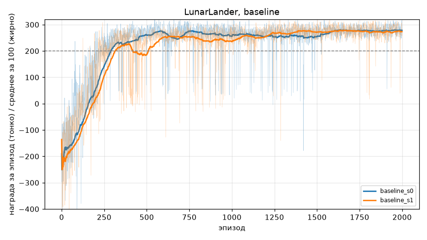
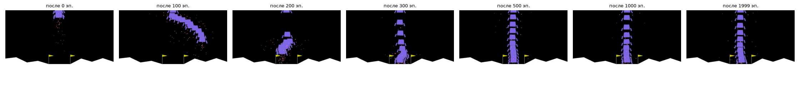
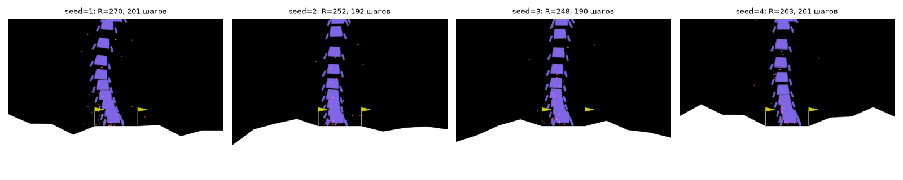
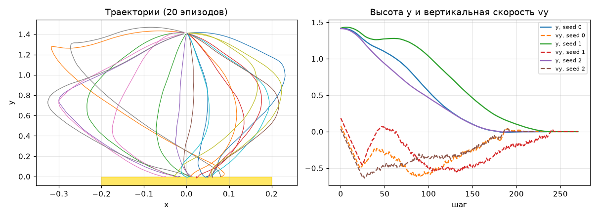
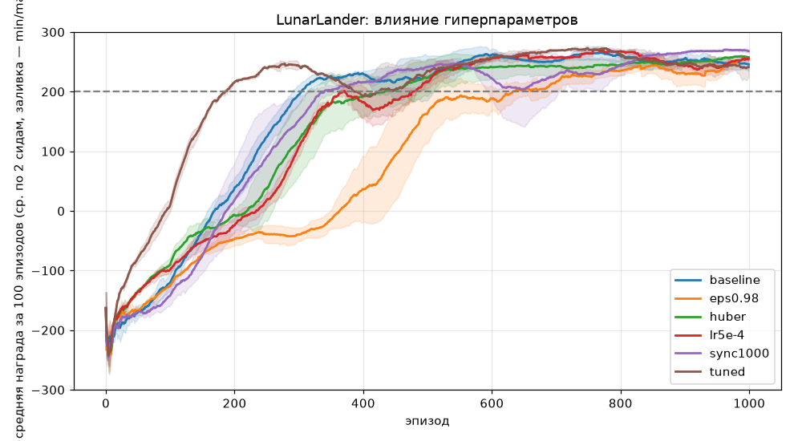
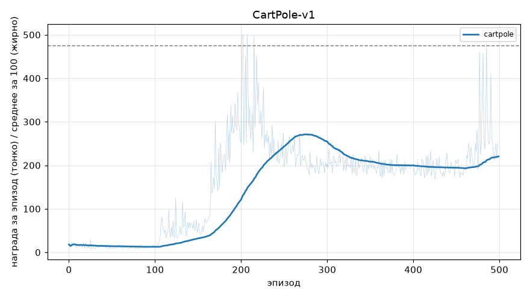
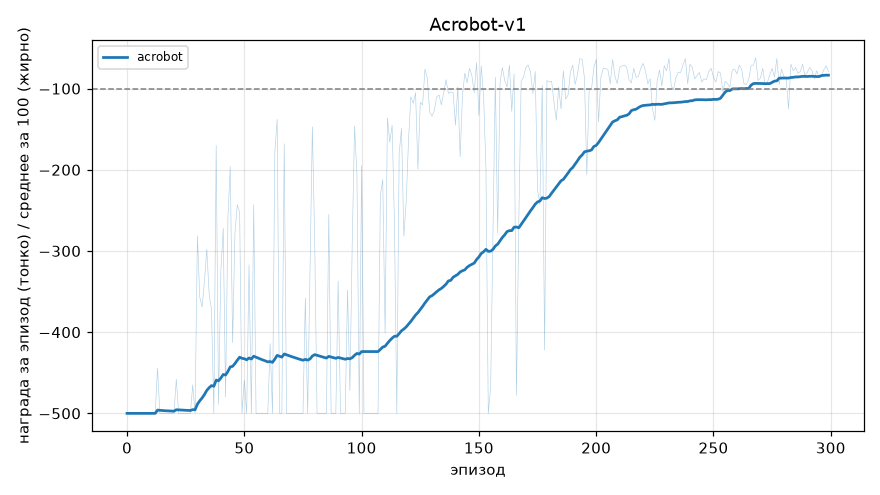

# Лабораторная работа 2. Глубокое Q-обучение (DQN) для посадки лунного модуля

**Цель:** реализовать алгоритм DQN и обучить агента посадке лунного модуля (`LunarLander-v3` из gymnasium).

## Состав

| Файл | Назначение |
|---|---|
| `dqn.py` | Реализация по методичке: `Q_network`, `ReplayBuffer`, `Agent` (с дописанной функцией ошибки в `train_iteration`), цикл обучения, `visualize_episode`. Гиперпараметры собраны в `Config` и задаются из командной строки |
| `run_experiments.sh` | Все запуски: базовый вариант, варианты гиперпараметров (по 2 сида), другие среды |
| `analyze.py` | Графики, сводная таблица, визуализация стратегии |
| `results/` | Графики, GIF с посадками, `summary.json` (все числа), `strategy.json`, веса лучшей модели `q_best_baseline.pt` |

Запуск:
```bash
pip install -r requirements.txt
python dqn.py                  # обучение с параметрами из методички (2000 эпизодов, ~15 мин на 1 ядре CPU)
./run_experiments.sh           # все эксперименты (4 процесса параллельно)
python analyze.py              # графики и таблицы в results/
```
Видео эпизодов во время обучения (каждые 100 эпизодов, как в методичке) пишутся в `runs/<имя>/recording/`.

## Реализация функции ошибки

Пропущенный в методичке фрагмент `train_iteration`:

```python
action_values = self.Q(states)                          # Q(s_t, ·; θ)
Qs = action_values.gather(index=actions, dim=1)         # Q(s_t, a_t; θ)
with torch.no_grad():
    Q_next_max = self.target_Net(next_states).max(dim=1, keepdim=True)[0]   # max_a' Q(s_{t+1}, a'; θ⁻)
    Q_next_max[dones] = 0.0                              # эпизод закончен → будущего нет
    target = rewards + GAMMA * Q_next_max                # правая часть уравнения Беллмана
loss = nn.MSELoss()(Qs, target)                         # (r + γ·max Q⁻ − Q)²
```
Целевая сеть вычисляется под `no_grad`: градиент идёт только через Q(s_t, a_t; θ) основной сети.
Опционально поддерживаются Huber loss (`--loss huber`), Double DQN (`--double-dqn true`) и Adam (`--optimizer adam`).

**Отличия от кода методички:**
* в буфер в качестве `done` пишется `terminated`, а не `terminated or truncated`: обрыв эпизода по лимиту в 1000 шагов не означает,
  что будущая ценность равна 0 (поведение методички включается флагом `--done-on-truncation true`);
* добавлены сиды, сохранение лучшей модели (по среднему за 100 эпизодов), итоговая оценка жадной стратегии на 100 новых
  случайных конфигурациях среды, режим синхронизации целевой сети по числу шагов обучения (`--sync-mode steps`);
* вместо `drawnow` (интерактивное окно) графики строятся после обучения в `analyze.py`; обучение шло на CPU (GPU нет).

## 1. Обучение с параметрами из методички

`LR=1e-4, GAMMA=0.99, EPSILON_DECAY=0.99, BATCH=64, BUFFER=65536, сеть 8→256→128→4, RMSprop, SYNC_ITERATIONS=2`.



| Сид | Средняя за 100 ≥ 200 впервые на эпизоде | Шагов среды до этого | Лучшее среднее за 100 | Оценка на 100 новых эпизодах | Доля эпизодов ≥ 200 |
|---|---|---|---|---|---|
| 0 | 289 | 167 тыс. | 279.9 | **281.4 ± 19.5** | **100 %** |
| 1 | 314 | 181 тыс. | 278.5 | 268.8 | 95 % |

Задача решается надёжно (оба запуска) примерно за **300 эпизодов** (~170 тыс. шагов среды); к 2000 эпизодам средняя награда ≈ 275–280.

Как в методичке в начале обучения награда сильно отрицательная (−150…−250): при ε≈1 модуль падает или улетает.

### Эволюция поведения (аналог рисунка 3 методички)

Одна и та же конфигурация среды (seed=101), наложенные кадры эпизода:



* **0 эпизодов** — случайная сеть: двигатели не используются осмысленно, модуль падает.
* **100 эпизодов** — агент научился не разбиваться, «зависая» на главном двигателе, но его сносит в сторону и он улетает из кадра.
* **200 эпизодов** — долетает до площадки, но садится грубо, с наклоном.
* **300 эпизодов** — садится на площадку, но долго «елозит» боковыми двигателями у поверхности.
* **500–2000 эпизодов** — прямой быстрый спуск в центр площадки и мягкая посадка.

### Несколько разных конфигураций среды (доп. задание 1)

В методичке визуализация всегда делается на seed=101. Функция `visualize_episode` в `dqn.py` принимает список сидов и записывает
отдельное видео для каждого (`RecordVideo` c `episode_trigger=lambda ep: True`), а `analyze.py` дополнительно сохраняет GIF.
Лучшая модель на 4 разных случайных конфигурациях (разный рельеф и начальный толчок):



GIF: [seed 1](results/landings_best_seed1.gif), [seed 2](results/landings_best_seed2.gif),
[seed 3](results/landings_best_seed3.gif), [seed 4](results/landings_best_seed4.gif).

### Какую стратегию выучил агент



Статистика по 20 новым эпизодам (`results/strategy.json`): средняя награда 285, средняя длина эпизода 208 шагов;
действия: главный двигатель — 48 %, ничего не делать — 30 %, боковые — 11 % и 10 %.

* **Сначала гасится начальный толчок**: модуль стартует со случайной горизонтальной скоростью, агент боковыми двигателями
  разворачивает его и уводит обратно к x = 0 (петлеобразные траектории слева).
* **Спуск с контролируемой скоростью**: главный двигатель работает импульсами, удерживая |vy| ≈ 0.3–0.5 и плавно гася её к поверхности
  (график справа). Это «bang-bang» управление, соответствующее принципу максимума Понтрягина, упомянутому в методичке.
* **Экономия топлива**: главный двигатель штрафуется в 10 раз сильнее бокового (−0.3 против −0.03 за кадр), поэтому агент не висит
  долго над поверхностью, а садится за ~200 шагов, причём почти треть времени двигатели выключены.
* **После касания** агент выключает двигатели, модуль «засыпает» — эпизод заканчивается с бонусом +100.

## 2. Подбор гиперпараметров (доп. задание 2)

Каждый вариант отличается от базового **одним** параметром (кроме `tuned`), 1000 эпизодов, 2 сида.
Надёжность — оценка лучшей модели на 100 новых эпизодах; скорость — эпизод и число шагов среды,
когда среднее за 100 впервые достигло 200.



| Вариант | Изменение | Эпизод решения (сид 0 / 1) | Шагов среды до решения, тыс. | Лучшее среднее за 100 | Оценка итоговой модели (100 эп.) |
|---|---|---|---|---|---|
| baseline | параметры методички | 289 / 314 | 167 / 181 | 279.9 / 278.5 | 281 / 269 |
| sync1000 | целевая сеть каждые 1000 шагов обучения | 362 / 320 | 205 / 162 | 272.7 / 268.7 | 257 / 264 |
| lr5e-4 | LR = 5e-4 | 483 / 362 | 229 / 202 | 270.2 / 275.1 | 180 / 262 |
| huber | Huber loss вместо MSE | 507 / 314 | 318 / 170 | 258.7 / 264.5 | 268 / 251 |
| eps0.98 | EPSILON_DECAY = 0.98 | 487 / 695 | 336 / 473 | 261.5 / 254.8 | 242 / 264 |
| **tuned** | Adam, LR=5e-4, Huber, Double DQN, sync 500 шагов, EPSILON_DECAY=0.98 | **190 / 182** | **100 / 101** | 273.4 / 277.2 | 249 / 232 |

(Время обучения в `summary.json` не сравнимо между запусками: 4 процесса делили 4 ядра.)

Выводы:
* **Параметры методички уже хорошо подобраны**: решение за ~300 эпизодов в обоих сидах и лучшее итоговое качество.
  Заметим, что `SYNC_ITERATIONS=2` проверяется только в конце эпизода, поэтому целевая сеть фактически обновляется в среднем
  раз в 2 эпизода, т. е. каждые несколько сотен шагов обучения, а не каждые 2 шага.
* **Самая быстрая сходимость — у комбинации `tuned`**: 180–190 эпизодов и ~100 тыс. шагов среды, т. е. в **1.7 раза быстрее**
  базового варианта, стабильно на обоих сидах. Основной вклад дают Adam с большим LR и Double DQN (без завышенной оценки max Q).
  Цена — меньшая стабильность в конце: у сида 0 после 700 эпизодов среднее просело до 224, итоговая модель слабее базовой.
  Для практики разумно брать `tuned` и сохранять лучшую модель (что и делает `dqn.py`, `q_best.pt`).
* **Более быстрое уменьшение ε (0.98) вредит**: агент рано перестаёт исследовать, застревает в локальной стратегии
  «зависнуть в воздухе» (эпизоды по 1000 шагов с наградой около −30…0) и долго из неё выбирается — худшая скорость
  (500–700 эпизодов).
* **LR = 5e-4 с RMSprop** ускоряет первую фазу, но делает обучение шумнее (у сида 0 итоговая модель только 180 очков).
* **Huber loss и редкая синхронизация (1000 шагов)** по отдельности не ускоряют обучение, но немного стабилизируют конец обучения
  (у sync1000 самый ровный хвост кривой).
* Между двумя сидами одного варианта разброс по скорости достигает 1.5 раз, поэтому выводы о небольших различиях
  (baseline vs sync1000 vs huber) статистически ненадёжны; устойчиво видны только эффекты `tuned` (быстрее) и `eps0.98` (медленнее).

## 3. Другие среды (доп. задание 3)

Программа работает без изменений кода для любой среды с дискретными действиями и векторным наблюдением (меняется только `--env`).

| Среда | Эпизодов | Критерий решения | Результат |
|---|---|---|---|
| CartPole-v1 | 500 | среднее ≥ 475 | достигает 500 в отдельных эпизодах, лучшее среднее за 100 = 271, оценка итоговой модели 269 (91 % эпизодов ≥ 200); после пика — провал («катастрофическое забывание»), критерий не достигнут |
| Acrobot-v1 | 300 | среднее ≥ −100 | **решено** на 262-м эпизоде, оценка −82 |
| MountainCar-v0 | 500 | среднее ≥ −110 | **не решено**: −200 (ни разу не доехал до флага) |

 

* **CartPole** учится быстро, но DQN с параметрами для LunarLander нестабилен: награда постоянна (+1 за шаг), и после того как буфер
  заполнился только «хорошими» переходами, сеть переоценивает Q и стратегия деградирует. Помогает меньший LR, редкая синхронизация
  и ранняя остановка по лучшей модели.
* **Acrobot** решается с теми же параметрами.
* **MountainCar** — пример среды, где этот DQN не работает: награда −1 за каждый шаг и никаких промежуточных подсказок, а случайными
  действиями тележка практически никогда не доезжает до вершины. Нужна более сильная стратегия исследования
  (например, долгое ε≈1, шум в параметрах, бонус за новизну) или формирование награды (reward shaping, например за скорость/высоту).

## 4. Выводы

1. Реализованный DQN (основная сеть + целевая сеть + буфер повторов + ε-жадное исследование) решает LunarLander:
   с параметрами методички средняя награда за 100 эпизодов превышает 200 примерно к 300-му эпизоду, итоговая модель набирает
   ≈ 270–280 очков, успешно садясь в 95–100 % случайных конфигураций.
2. Агент выучивает осмысленную стратегию: гасит начальный толчок боковыми двигателями, возвращается к центру, спускается
   импульсами главного двигателя с контролем вертикальной скорости и отключает двигатели после касания.
3. На скорость сильнее всего влияют алгоритмические улучшения (Double DQN, Adam) и скорость уменьшения ε; комбинация
   улучшений ускоряет решение в ~1.7 раза, но слегка снижает стабильность в конце обучения.
4. Тот же код без изменений решает Acrobot и почти решает CartPole, но не справляется с MountainCar, где награда разрежена.

## Ответы на вопросы для самопроверки

1. **Почему итерация по ценностям действий не работает для LunarLander?** Пространство состояний непрерывное (8 вещественных чисел):
   таблицу Q(s, a) и таблицу переходов построить нельзя — каждое состояние встречается один раз, перебрать все состояния невозможно,
   модель переходов неизвестна. Нужна аппроксимация Q-функции (нейросеть), обобщающая на близкие состояния.
2. **Зачем буфер повторов?** Последовательные переходы сильно коррелированы, а градиентный спуск предполагает независимые примеры.
   Случайная выборка из буфера разрывает корреляции, позволяет многократно использовать опыт (эффективность по данным)
   и сглаживает распределение обучающих данных при изменении стратегии.
3. **Преимущества gym/gymnasium?** Единый интерфейс `reset/step` для сотен сред — один и тот же код агента работает с
   LunarLander, CartPole, Acrobot (что и показано в доп. задании 3); готовые обёртки (запись видео, лимит времени), воспроизводимость по сидам,
   стандартные критерии решения для сравнения алгоритмов.
4. **Чем обосновывается выбор архитектуры сети?** Типом наблюдения: вектор признаков без пространственной структуры → полносвязная сеть
   (для изображений — свёрточная, для последовательностей — рекуррентная). Вход = размерность наблюдения (8), выход = число
   дискретных действий (4) — одна прямая передача даёт Q всех действий. Размер скрытых слоёв подбирается: достаточный для
   аппроксимации нелинейной Q-функции, но не слишком большой, чтобы не замедлять и не дестабилизировать обучение.
5. **Зачем ε?** Для баланса исследования и использования. Без случайных действий жадный агент повторял бы то, что сеть считает лучшим
   по недообученным оценкам, и никогда не узнал бы о лучших действиях. ε уменьшается: в начале почти всё случайно, в конце —
   в основном жадно. Эксперимент eps0.98 показывает, что слишком быстрое уменьшение ε приводит к застреванию в плохой стратегии.
6. **Зачем две сети?** Цель r + γ·max Q(s′, a′) зависит от тех же параметров, что и предсказание. Если считать её той же сетью, каждое
   обновление сдвигает и цель («погоня за собственным хвостом»), а т. к. s и s′ близки, ошибки усиливаются и обучение расходится.
   Целевая сеть θ⁻ заморожена между синхронизациями, поэтому цель стационарна на этом отрезке и обучение стабилизируется.
